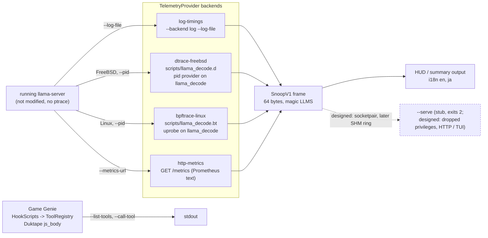
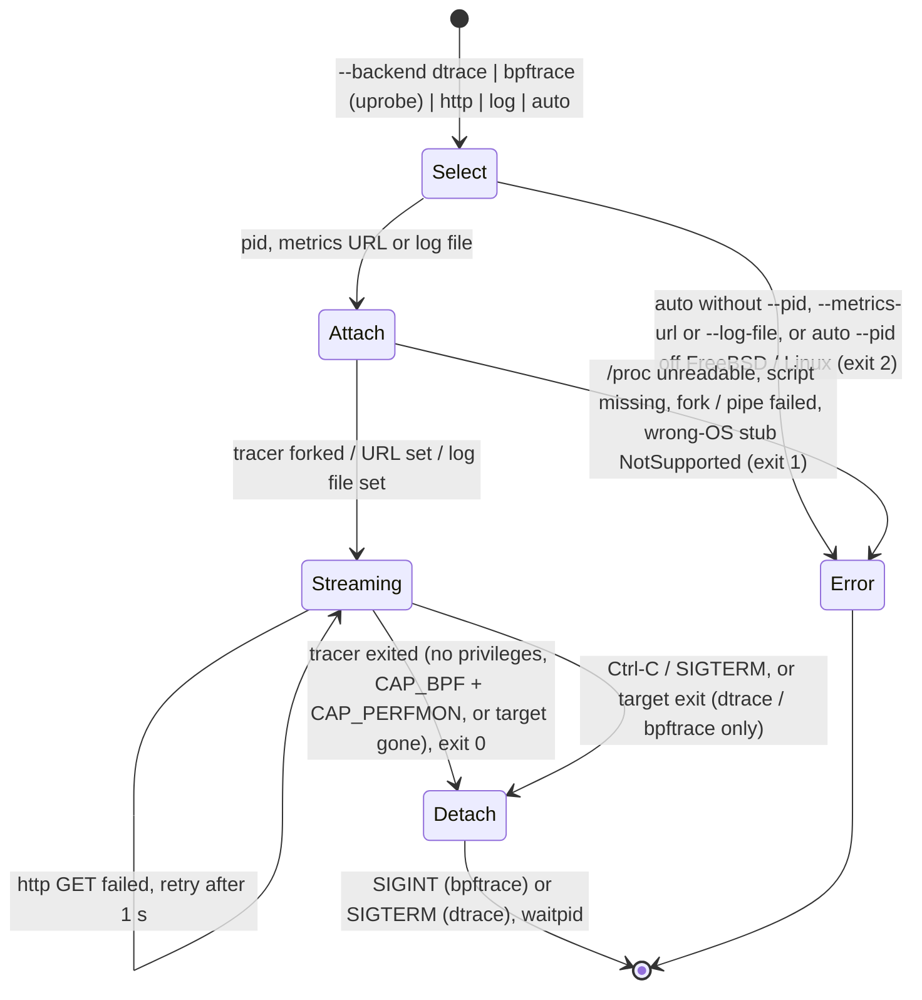
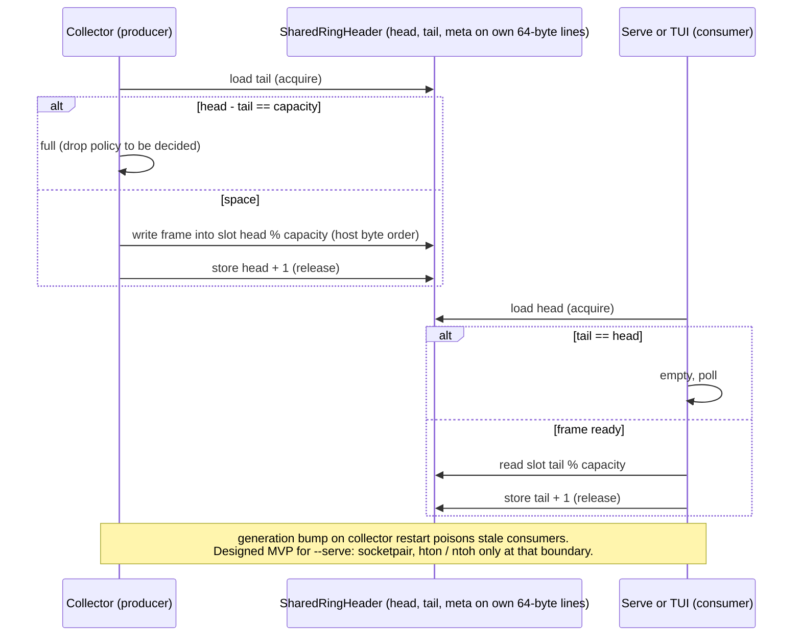
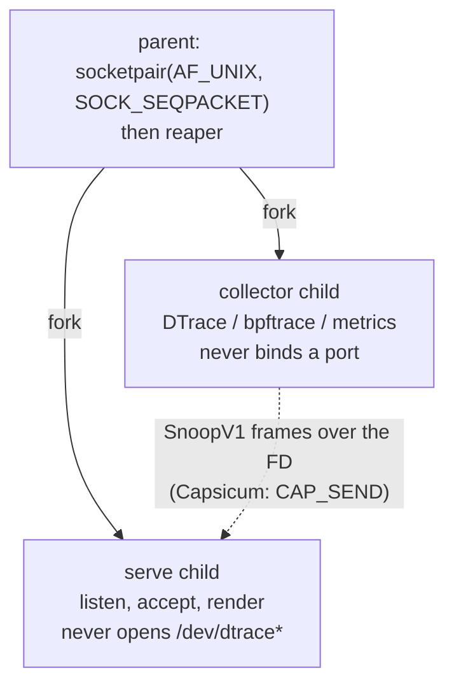
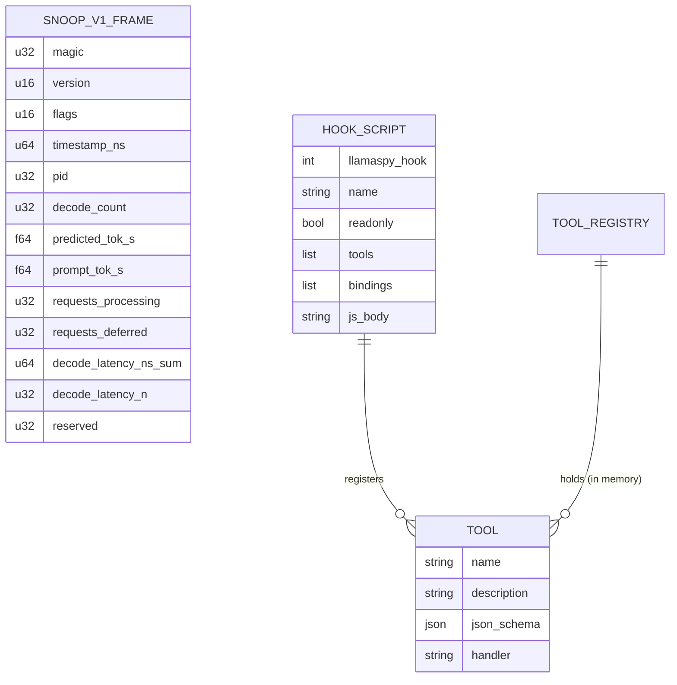
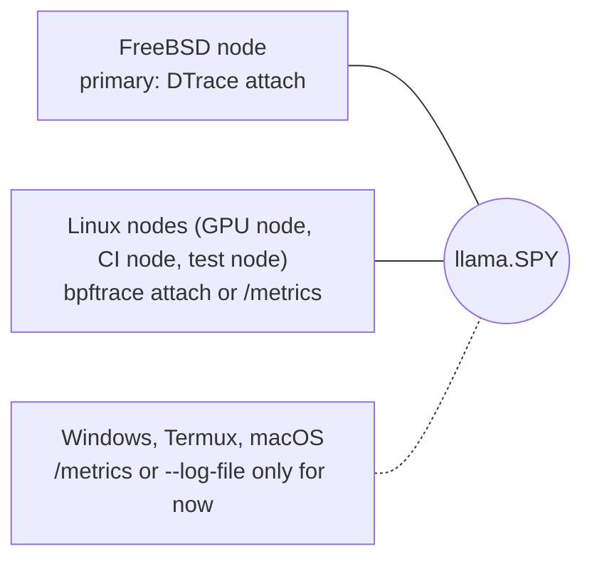

# llama.SPY

**FreeBSD-first** C++20 realtime observability for a running [llama.cpp](https://github.com/ggml-org/llama.cpp) process — zero restart, read-only MVP.

Also known in design discussions as *LlamaSpy* / *LlamaSnoop* (codename aliases).

Primary backend: **DTrace** userland `pid` provider on `llama_decode` (`scripts/llama_decode.d`).  
Portable fallback: poll `llama-server` **HTTP `/metrics`** (Prometheus text).

Hermes is an example stack only.

## Prebuilt test builds

Download a ready-to-run bundle from [Releases](https://github.com/brianreborn/llama.SPY/releases) (latest **v0.1.0-test2**: Linux + FreeBSD live attach).

- Linux amd64: unpack and run `./bin/run-hook-smoke.sh` — see [README-PREBUILT.md](README-PREBUILT.md)
- FreeBSD amd64: attached when CI / qodesh produces it

---

## Build

### FreeBSD (primary)

```sh
pkg install cmake llvm   # dtrace is usually in base; ensure C++20 toolchain
cmake -B build -DCMAKE_BUILD_TYPE=Release
cmake --build build
```

On FreeBSD, CMake defines `LLAMASPY_FREEBSD=1`, enabling the real DTrace provider (sources gate on `LLAMASPY_FREEBSD || __FreeBSD__`).

### DTrace script resolution

First match wins:
1. `--dtrace-script PATH`
2. env `LLAMASPY_DTRACE_SCRIPT`
3. `scripts/llama_decode.d` relative to cwd
4. beside the executable (`<exe>/llama_decode.d`, `<exe>/scripts/`, `<exe>/../scripts/`, `<exe>/../share/llamaspy/`)
5. compile-time install dir `${CMAKE_INSTALL_PREFIX}/share/llamaspy/llama_decode.d` (set prefix at configure: `cmake -DCMAKE_INSTALL_PREFIX=/usr/local ..`)

### Linux (HTTP + bpftrace live attach)

```sh
cmake -B build -DCMAKE_BUILD_TYPE=Release
cmake --build build
```

Live attach uses **bpftrace uprobes** on `llama_decode` (`--backend bpftrace` or `auto --pid PID`), mirroring `scripts/llama_decode.d` via `scripts/llama_decode.bt`. The target ELF is `libllama*.so` from `/proc/PID/maps`, else `/proc/PID/exe`. Needs `bpftrace` installed and root (or CAP_BPF+CAP_PERFMON; CAP_SYS_ADMIN on older kernels). Read-only, no ptrace, target untouched. Same `ts n avg_ns` lines → SnoopV1 frames as DTrace.

Shared smoke for both OSes: `bin/run-attach-smoke.sh [--pid PID] [--metrics-url URL]`.

Dependencies: C++20 STL + POSIX sockets + vendored Duktape C amalgamation (no Boost, no libcurl, no system JS package).  
Binary name: `llamaspy` (filesystem-safe); product name: **llama.SPY**.

## Run

### FreeBSD — DTrace (preferred)

```sh
# as root or with dtrace privileges; target already running
./build/llamaspy --backend dtrace --pid $(pgrep -n llama-server) \
  --dtrace-script scripts/llama_decode.d
```

Or `auto` with a pid:

```sh
./build/llamaspy --backend auto --pid $PID
```

### Anywhere — HTTP `/metrics`

Start llama-server with `--metrics`, then:

```sh
./build/llamaspy --backend http \
  --metrics-url http://127.0.0.1:8080/metrics
```

Optional HTTP enrichment (same host/port `/slots` by default; Bearer via `--api-key`):

```sh
./build/llamaspy --backend http \
  --metrics-url http://127.0.0.1:8080/metrics \
  --slots-url http://127.0.0.1:8080/slots \
  --api-key "$LLAMA_API_KEY"
```

Cooperative log timing stub (no FD hijack yet) — see [docs/METRICS_MAP.md](docs/METRICS_MAP.md):

```sh
./build/llamaspy --backend log --log-file /path/to/llama.log --no-hud
```

Default: a one-pane ANSI **HUD** refreshes each poll (gen/ingest tok/s, busy
slots, `n_decode` + decode rate, attach-mode badge `dtrace|http|log|auto`).
Pass `--no-hud` for classic one-line `[SnoopV1]` summaries instead.

### Game Genie — HookScripts that mint tool calls

Paste-in hooks (DTrace-shaped) that register **tool calls** into an in-memory
`ToolRegistry`. JSON HookScript is the primary path; LLMS1 offset codes are a
simple dialect. See [docs/GAME_GENIE.md](docs/GAME_GENIE.md).

```sh
# load HookScript, register tools (manifest + js_body), list, exit
./build/llamaspy --hook-file examples/hook.sample.json --list-tools

# invoke a JS-registered tool
./build/llamaspy --hook-file examples/hook.sample.json \
  --call-tool add '{"a":2,"b":3}'

# LLMS1 simple dialect still works
./build/llamaspy --gg-file examples/codes.sample.gg

# URL import is a stub (review-before-load later; no remote exec)
./build/llamaspy --from-url https://example.com/hooks/slot-watch.json
```

`js_body` runs in **vendored Duktape** (`third_party/duktape`, default
`-DLLAMASPY_JS=ON`). Host API: `registerTool`, `log`, `readBinding` (metadata
stub) — **no net, no fs**. Read-only default; own-process only. Delivery prior
art: [phantom-kv](https://github.com/lordx64/phantom-kv) (loadable reversible
grafts) — observability tooling only, not refusal-removal.

### i18n

CLI help + HUD labels via `T("key")`. Auto-pick: `LLAMASPY_LANG` → `LANG` /
`LC_MESSAGES` (prefix `en`, `ja`, …); fallback `en`. Ship `locales/en.json` +
`locales/ja.json`. **Add a language:** copy `locales/en.json` → `locales/xx.json`
(and extend the built-in table until a JSON loader lands). No gettext toolchain.

## Diagrams

Mermaid diagrams of `main` (`a0f4916`, v0.1.0-test2), rendered by GitHub. The text privsep diagram in [docs/PRIVSEP.md](docs/PRIVSEP.md) and the SnoopV1 / ring tables in [docs/DESIGN.md](docs/DESIGN.md) stay as they are. Dashed parts are designed, not implemented.

### Components and data path



`auto` picks DTrace on FreeBSD and bpftrace on Linux when `--pid` is given; otherwise it needs `--metrics-url` or `--log-file`. On other systems `auto --pid` errors (no live-attach backend). `uprobe` is an alias for `bpftrace`. `--serve` is drawn dashed because it is a stub that exits 2.

### Provider lifecycle



### IPC: SPSC ring (designed, not implemented)



### Privilege separation (designed for `--serve`)



### Data model



### Where it runs



## Layout

```
include/llamaspy/   snoop_v1, telemetry_provider, metrics_http, tui_stub, game_genie,
                   hook_script, tool_registry, js_engine, i18n
src/                main, metrics_http, provider_dtrace_freebsd, tui_stub, game_genie,
                   hook_script, tool_registry, js_engine, log_timings, i18n
third_party/        duktape/ (vendored amalgamation for js_body)
scripts/            llama_decode.d
examples/           hook.sample.json, codes.sample.gg
locales/            en.json, ja.json
docs/               DESIGN, PRIOR_ART, PRIVSEP, GAME_GENIE, METRICS_MAP
```

Repo directory: `/workspace/llama.SPY`.

## Docs

- [Design notes](docs/DESIGN.md) — SnoopV1, IPC `alignas(64)`, Capsicum privsep, Game Genie paste-in
- [Game Genie / HookScripts](docs/GAME_GENIE.md) — hooks that mint tools; `--hook-file` / `--list-tools`
- [Privilege separation](docs/PRIVSEP.md) — FreeBSD Capsicum + socketpair; Linux landlock/seccomp sketch
- [Prior art](docs/PRIOR_ART.md) — verified links; FreeBSD-first override noted at top

## Status

Scaffold: builds on Linux (HTTP + HUD + HookScript/ToolRegistry + Duktape `js_body` + i18n en/ja), FreeBSD DTrace behind `#if defined(LLAMASPY_FREEBSD) || defined(__FreeBSD__)`. No memory writes. `--serve` documented, not implemented. FreeBSD live testing deferred until first-test e2e. Fullscreen TUI later.

## Localization

UI strings (banner, help, HUD labels) come from flat JSON in `locales/<lang>.json`. Language is picked from `--lang xx`, else `LLAMASPY_LANG`, `LC_ALL`, `LANG` (`ja_JP.UTF-8` → `ja`), default `en`; missing keys fall back to English, then the key. Files are searched in `$LLAMASPY_LOCALEDIR`, `./locales`, beside the exe (and its parent), and `share/llamaspy/locales`.
**Add a language:** copy `locales/en.json` to `locales/xx.json` and translate the values. No gettext.
